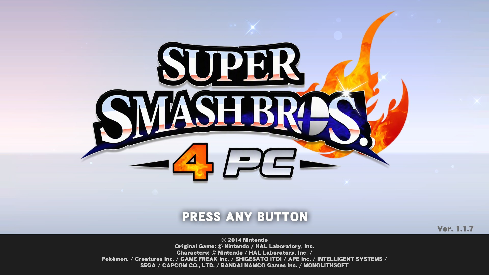
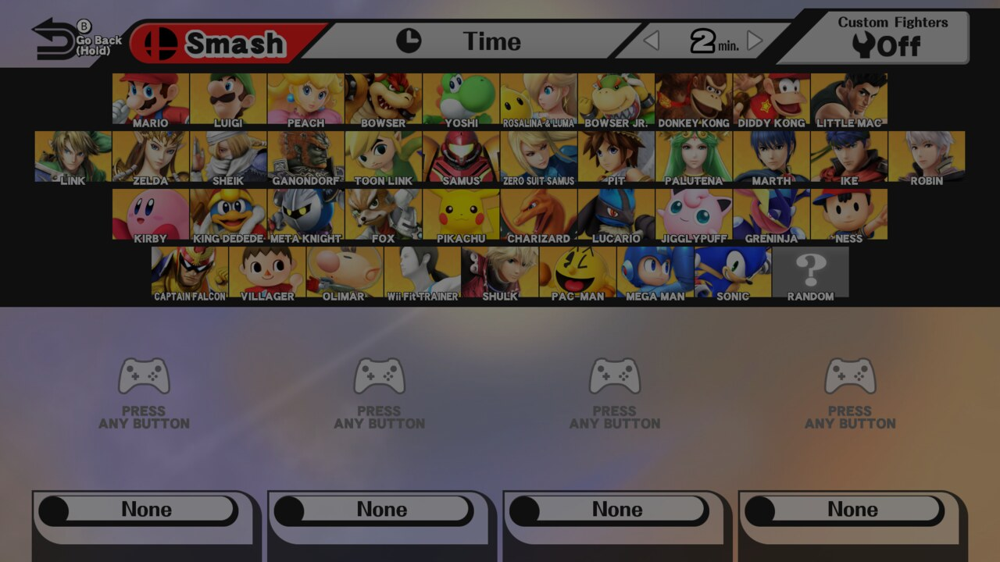
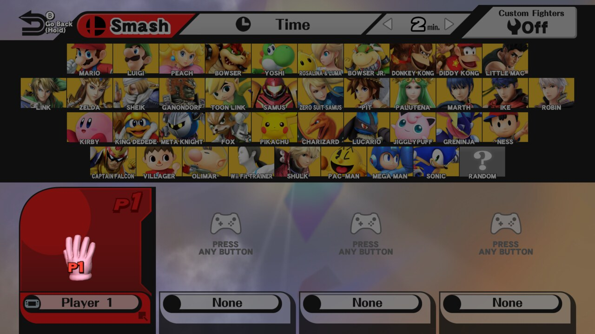
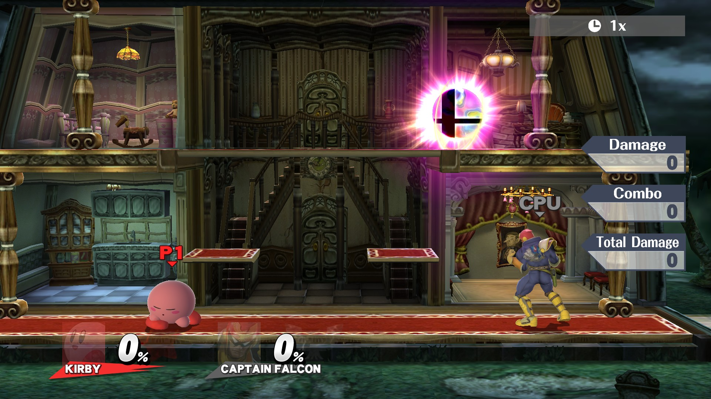
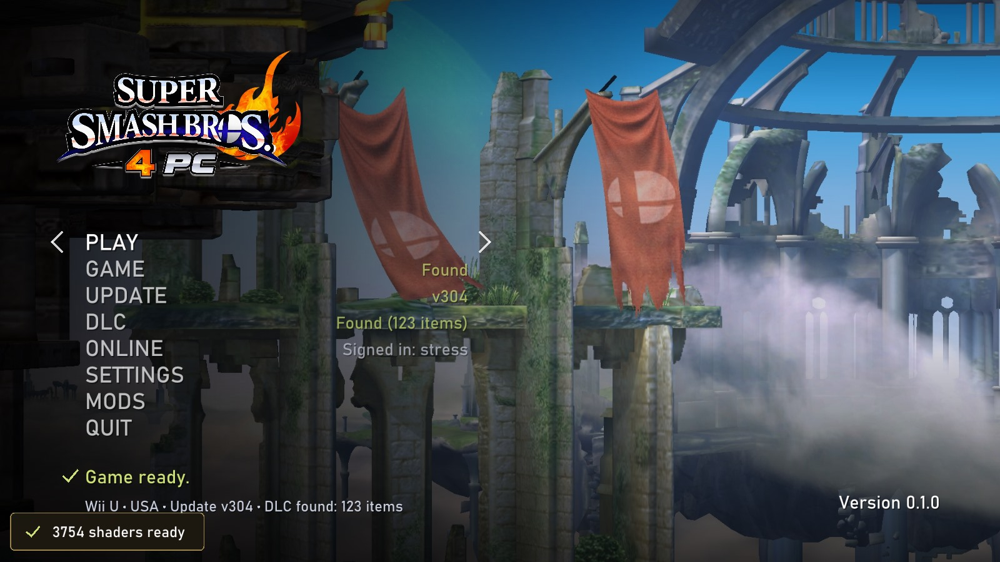

# Smash 4 PC

A native Windows port of **Super Smash Bros. for Wii U**, statically recompiled from the game's PowerPC code: the
game's code is translated to C++ ahead of time and runs as native x86-64 code on a reimplementation of the Wii U's
system libraries, with its GPU commands and shaders translated to Vulkan. No emulator.

> [!IMPORTANT]
> **No game files are included.** You need your own dump of Super Smash Bros. for Wii U (USA) from your own Wii U.
> This project is not affiliated with or endorsed by Nintendo, Bandai Namco or Sora Ltd.



| | |
|---|---|
|  |  |
|  |  |

## Features

- **Plays the game natively**, from the update (v304, all fighters and stages) or the game's own v1.0, with DLC
  from your own DLC dump: Smash, 8-Player Smash and the game's other modes.
- **Up to 4K and 5K**, drawn at that resolution rather than upscaled, fullscreen or in a window.
- **60, 120 or uncapped frame rates**: above 60 the game's frames are interpolated; the game itself runs at 60.
- **Controllers**: XInput, PlayStation, Switch Pro and other SDL pads, plus the keyboard. The first pad (and the
  keyboard) is the GamePad; every further pad is a Wii U Pro Controller, so 8-Player Smash works locally.
- **Online on Pretendo Network**: Smash's own online modes, with your Wii U's console files and your Pretendo ID,
  signed in from the launcher.
- **Mods**: `content\` mods (Sm4shExplorer packs, SDCafiine mods, Cemu graphic packs), installed from a .zip, .7z
  or .rar in the launcher and switched on or off there.
- **A launcher** for the game, update and DLC folders, display settings, mods and online, and an in-game menu
  (Esc or a pad's Home button) for the frame counter, fullscreen and frame rate.

## Install

1. Download `Smash4PC-v0.1.0-Windows.zip` from [Releases](../../releases) and unzip it anywhere.
2. Run **Smash 4 PC.exe** and choose **PLAY**. It asks for your game folder (`0005000010144F00`), then the update
   (`0005000E10144F00`, recommended) and the DLC (`0005000C10144F00`, optional): the folders Cemu uses, dumped
   with Dumpling.
3. Play. Shaders compile the first time each is seen, then load from `cache\` at start-up.

Needs Windows 10 or 11 (64-bit) and a GPU with Vulkan 1.3. The full guide (controls, mods, online,
troubleshooting) is [assets/smash/README.txt](assets/smash/README.txt), also in the release zip.

## Building from source

You need Windows, Python 3, Git, about 16 GB of RAM, and a folder holding this repository and a `toolchain\`
folder beside it with [llvm-mingw](https://github.com/mstorsjo/llvm-mingw), Ninja and CMake:

```
Smash4PC\
  toolchain\llvm-mingw\  toolchain\Ninja\  toolchain\CMake\
  upstream\              (this repository)
```

```powershell
# Fetches and builds the dependencies once, builds the recompiler, translates your cross_f.rpx files and builds
# smash.exe (the update's code), smash-base.exe (the game's own) and the launcher into ..\Play.
.\upstream\tools\windows\build-smash.ps1 -Rpx '<update>\code\cross_f.rpx' -BaseRpx '<game>\code\cross_f.rpx'
# The release zip, in ..\dist.
.\upstream\tools\windows\package-release.ps1
```

The translated code (`..\generated`) and the programs built from it contain the game's code: don't upload them
or attach them to issues.

## Credits

- Built on [Tekken Tag 2 Ultimate Edition](https://github.com/Petexy/Tekken-Tag-2-Ultimate-Edition)'s cafe-recomp
  and Wii U runtime by Petexy (MIT).
- Nintendo Network code from [Cemu](https://github.com/cemu-project/Cemu) (MPL 2.0), and the
  [Pretendo Network](https://pretendo.network) team for keeping Wii U online alive.
- SDL3, shaderc, glslang, SPIRV-Tools, the Vulkan headers, zlib, zstd, ZArchive, AMD's addrlib and stb.

Smash 4 PC's code is under the MIT license ([LICENSE](LICENSE)); third-party code keeps its own license.
